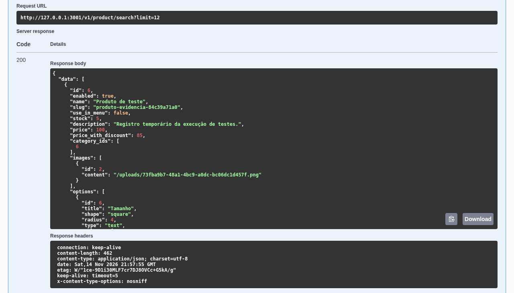
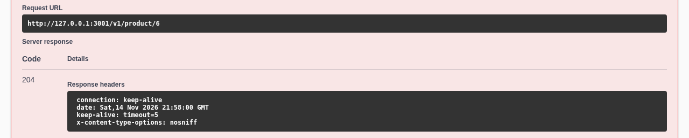
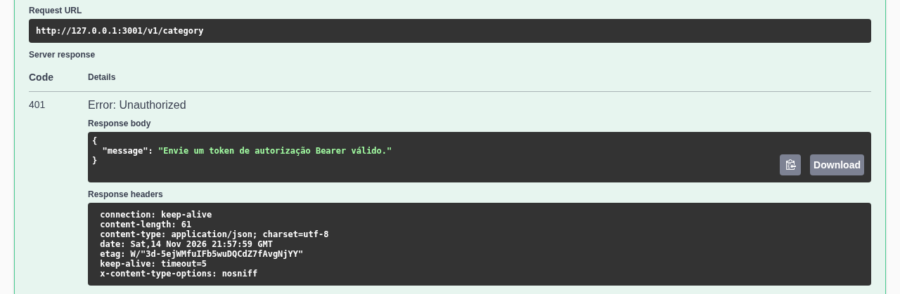

# Evidências de execução

As imagens desta pasta são capturas diretas do Swagger UI após executar requisições contra a API e o MySQL. Os recortes mostram **Request URL** e **Server response**, com os códigos HTTP e os dados recebidos. Os blocos **Example Value** são exemplos de documentação e ficam fora das evidências.

## Ambiente e execução

- Código verificado: [`1d68b4c`](https://github.com/Liucera/digital-store-backend/commit/1d68b4ce3be2bad6af7dd6006d7f640c3d999809).
- Ambiente: Linux, Node.js v24.22.1, npm 11.9.0, MySQL 8.4.13 e Chromium.
- Testes Jest: de 14/11/2026 às 17:50:41 até 14/11/2026 às 17:50:47.
- Swagger: de 14/11/2026 às 18:57:41 até 14/11/2026 às 18:58:05.
- Fuso: America/Sao_Paulo, UTC−3.
- Dados fictícios exclusivos da execução. Usuário, categoria e produto foram excluídos ao concluir o fluxo.

## Testes automatizados

**31 testes aprovados, 0 falhas e 0 pendentes**, com código de saída 0.

- [Saída real do comando Jest](testes-jest.txt).
- [Resumo e resultados dos 31 testes](resumo-testes.json).
- [Requisições, respostas, horários e hashes das capturas](execucao-swagger.json).

## Capturas do Swagger

Foram executadas e capturadas **23 requisições**, abrangendo as **15 operações** da API. As consultas após alterações confirmam os novos dados; as consultas após exclusões retornam 404. Os retornos 401 e 404 abaixo são os resultados esperados dos testes de erro.

Na captura 02, o recorte termina antes do corpo que contém o JWT. O comando curl com o cabeçalho Authorization também fica fora das imagens. Tokens e senhas estão omitidos no JSON de registro. As respostas visíveis nas capturas não foram redesenhadas ou substituídas.

| Nº | Requisição executada | HTTP recebido | Imagem |
| --- | --- | --- | --- |
| 01 | `POST /v1/user` | 201 | [Captura](swagger-01-usuario-cadastro-201.png) |
| 02 | `POST /v1/user/token` | 200 | [Captura](swagger-02-autenticacao-200.png) |
| 03 | `GET /v1/user/7` | 200 | [Captura](swagger-03-usuario-consulta-200.png) |
| 04 | `PUT /v1/user/7` | 204 | [Captura](swagger-04-usuario-atualizacao-204.png) |
| 05 | `GET /v1/user/7` | 200 | [Captura](swagger-05-usuario-atualizado-200.png) |
| 06 | `POST /v1/category` | 201 | [Captura](swagger-06-categoria-cadastro-201.png) |
| 07 | `GET /v1/category/search` | 200 | [Captura](swagger-07-categorias-busca-200.png) |
| 08 | `GET /v1/category/6` | 200 | [Captura](swagger-08-categoria-consulta-200.png) |
| 09 | `PUT /v1/category/6` | 204 | [Captura](swagger-09-categoria-atualizacao-204.png) |
| 10 | `GET /v1/category/6` | 200 | [Captura](swagger-10-categoria-atualizada-200.png) |
| 11 | `POST /v1/product` | 201 | [Captura](swagger-11-produto-cadastro-201.png) |
| 12 | `GET /v1/product/search` | 200 | [Captura](swagger-12-produtos-busca-200.png) |
| 13 | `GET /v1/product/6` | 200 | [Captura](swagger-13-produto-consulta-200.png) |
| 14 | `PUT /v1/product/6` | 204 | [Captura](swagger-14-produto-atualizacao-204.png) |
| 15 | `GET /v1/product/6` | 200 | [Captura](swagger-15-produto-atualizado-200.png) |
| 16 | `POST /v1/category` | 401 | [Captura](swagger-16-acesso-sem-token-401.png) |
| 17 | `DELETE /v1/product/6` | 204 | [Captura](swagger-17-produto-exclusao-204.png) |
| 18 | `GET /v1/product/6` | 404 | [Captura](swagger-18-produto-excluido-404.png) |
| 19 | `DELETE /v1/category/6` | 204 | [Captura](swagger-19-categoria-exclusao-204.png) |
| 20 | `GET /v1/category/6` | 404 | [Captura](swagger-20-categoria-excluida-404.png) |
| 21 | `DELETE /v1/user/7` | 204 | [Captura](swagger-21-usuario-exclusao-204.png) |
| 22 | `GET /v1/user/7` | 404 | [Captura](swagger-22-usuario-excluido-404.png) |
| 23 | `POST /v1/category` | 401 | [Captura](swagger-23-token-de-conta-excluida-401.png) |

### Exemplo de consulta executada

### Exemplo de exclusão executada

### Exemplo de autenticação exigida

As capturas documentam essas requisições. A suíte Jest verifica cenários adicionais, incluindo filtros, imagens, limites e rollback, conforme o registro dos testes.
